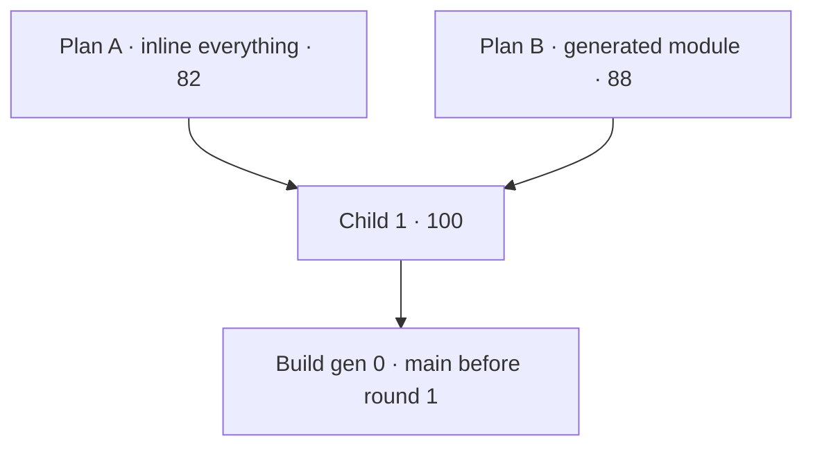
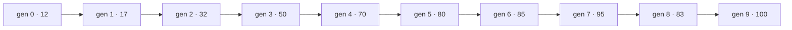

# Evolution log

How the import (Part 1 of the plan) is built, at the founder's request
(2026-10-07): every round starts with two competing plans. Each is scored,
and a child plan takes the best of both. The child is built. The build is
scored by `npm run score` (a script that tests real things, so the number is
not an opinion), and every generation's score is compared with every earlier
one. A round is done at **100**.

- **Plan score**: ten criteria, 10 points each, written down below before
  scoring.
- **Build score**: `node scripts/score.mjs --round N`. Every check is listed
  with its points. Generation 0 is `main` before the round starts.

## Plan rubric (10 points each)

1. **Coverage**: every bullet of the round in the spec maps to a task.
2. **Server authority**: the server recomputes everything that costs money and
   trusts nothing from the page.
3. **One source**: every number lives in `pricing.config.mjs` and
   `check:pricing` catches drift.
4. **Few copies**: the fewest places the same data is written (page weight,
   drift points).
5. **Testable**: each task starts from a failing test or check.
6. **House style**: fits the repo's patterns (BUILD markers, CommonJS API, no
   bundler, plain JS in the browser).
7. **Clear to the customer**: travel is its own line everywhere a price shows.
8. **Guesses marked**: every guessed value shows red with an asterisk and can
   be listed in one command.
9. **Failure handling**: unknown ZIP, too far, stale quote, missing data each
   have a defined, tested behavior.
10. **Small steps**: low blast radius, each task mergeable on its own.

---

## Round 1: service area and travel pricing

### Plan A: inline everything

Follow the existing pattern to the letter. `build-pricing` writes the full
ZIP to zone table into every BUILD block that needs it: the server
(`create-booking.js`), the quote page (twice: `quote-zips` and the
`LOAD_BUILDER` data), the checkout page and the homepage. Each page has its
own small lookup function. Guessed prices get a `guess` class where they are
generated.

| # | Criterion | Score | Why |
| --- | --- | --- | --- |
| 1 | Coverage | 10 | Every spec bullet has a task. |
| 2 | Server authority | 10 | Server looks the ZIP up in its own copy. |
| 3 | One source | 9 | All generated, but five lookup functions written by hand can disagree. |
| 4 | Few copies | 4 | About 160 ZIPs written five times; the homepage and quote carry it twice. |
| 5 | Testable | 7 | The server copy is testable; the four page copies are not. |
| 6 | House style | 10 | Exactly the current pattern. |
| 7 | Clear to the customer | 9 | Travel line on every surface. |
| 8 | Guesses marked | 6 | Marked where generated; JS-rendered prices are missed. |
| 9 | Failure handling | 8 | Too far and stale covered; page copies untested. |
| 10 | Small steps | 9 | Each surface is its own task. |
| | **Total** | **82** | |

### Plan B: one generated travel module

`build-pricing` writes two whole files instead of blocks: `api/_lib/travel.js`
(server, CommonJS) and `js/travel.js` (browser). Both hold the ZIP table and
the same `travelFor(zip)` function, emitted from one template. Every page and
every server file asks those modules. A `GUESS` flag set in the config drives
a red `.guess` style everywhere, including prices drawn by JavaScript.

| # | Criterion | Score | Why |
| --- | --- | --- | --- |
| 1 | Coverage | 9 | Misses the homepage area list and JSON-LD `areaServed`. |
| 2 | Server authority | 10 | Server uses its module; the page module is display only. |
| 3 | One source | 10 | One template, one function, two emitted copies checked to agree. |
| 4 | Few copies | 9 | Two copies of the table; the browser one is cached across pages. |
| 5 | Testable | 9 | Both modules load in Node; a test proves they agree for every ZIP. |
| 6 | House style | 7 | Whole generated files are new here; pages need one more script tag. |
| 7 | Clear to the customer | 9 | Travel line on every surface. |
| 8 | Guesses marked | 9 | Flag driven, so JS-drawn prices are marked too. |
| 9 | Failure handling | 9 | One tested lookup covers every caller. |
| 10 | Small steps | 7 | The module lands before anything uses it; a bigger first step. |
| | **Total** | **88** | |

### Child 1 (A × B)

From B: the two generated modules, one template, the agreement test, flag
driven guess marking. From A: keep BUILD blocks for per-page data (prices,
labels, the homepage area list, JSON-LD), and one task per surface, so each
step is small and reviewable. New in the child: the scorecard is written
first (the fitness function before the code), and `npm run guesses` lists
every guess for later.

| # | Criterion | Score | Why |
| --- | --- | --- | --- |
| 1 | Coverage | 10 | Every spec bullet, plus area list and JSON-LD from A. |
| 2 | Server authority | 10 | Server module only. |
| 3 | One source | 10 | From B. |
| 4 | Few copies | 9 | From B. |
| 5 | Testable | 10 | Scorecard first, unit tests for both modules, headless page checks. |
| 6 | House style | 10 | Modules sit beside BUILD blocks; `api/_lib/` already holds shared code. |
| 7 | Clear to the customer | 10 | Travel line everywhere, and the price waits for a ZIP instead of guessing it. |
| 8 | Guesses marked | 10 | Flag driven red asterisk plus `npm run guesses`. |
| 9 | Failure handling | 10 | Far ZIP, unknown ZIP, stale quote, ZIP+4, bad override: each tested. |
| 10 | Small steps | 10 | Module task is small because the scorecard and config come first. |
| | **Total** | **100** | |

Child 1 reaches 100 on the plan rubric, so it is the plan:
`docs/superpowers/plans/2026-10-07-round-1-travel-pricing.md`.

### Build generations

| Gen | Parent | What changed | Score | Best so far |
| --- | --- | --- | --- | --- |
| 0 | main (e702c16) | nothing yet: the scorecard alone | 12 | 12 |
| 1 | gen 0 | measured ZIP miles (Task 2) | 17 | 17 |
| 2 | gen 1 | zones, travel module (Task 3); guess marking (Task 4) | 32 | 32 |
| 3 | gen 2 | truck "+ travel", homepage zones and metro copy (Task 6); score moved to real 360px emulation | 50 | 50 |
| 4 | gen 3 | quote page prices travel, far ZIP call back, 16px and 48px fixes (Task 7) | 70 | 70 |
| 5 | gen 4 | checkout and thanks travel lines (Task 8) | 80 | 80 |
| 6 | gen 5 | scorecard reads nested tags (the thanks page was right, the reader was not) | 85 | 85 |
| 7 | gen 6 | Discord, email, database, dashboard (Task 9) | 95 | 95 |
| 8 | gen 7 | photo prompt and CLAUDE.md (Task 10); GUESSES.md picked up CLAUDE.md's description of the marker | 83 | 95 |
| 9 | gen 8 | CLAUDE.md excluded from the guess scan (it documents the convention) | **100** | **100** |

Every generation scored against the same 15 checks; the only regression
(gen 8, 95 → 83) was one stale generated list, fixed in gen 9.

