# Evolution log

How the import (Part 1 of the plan) is built, at the founder's request
(2026-10-07): every round starts with two competing plans. Each is scored,
and a child plan takes the best of both. The child is built. The build is
scored by `npm run score` (a script that tests real things, so the number is
not an opinion), and every generation's score is compared with every earlier
one. A round is done at **100**.

- **Plan score**: ten criteria, 10 points each, written down below before
  scoring.
- **Build score**: `node scripts/score.mjs --round N`. Every check is listed
  with its points. Generation 0 is `main` before the round starts.

## Plan rubric (10 points each)

1. **Coverage**: every bullet of the round in the spec maps to a task.
2. **Server authority**: the server recomputes everything that costs money and
   trusts nothing from the page.
3. **One source**: every number lives in `pricing.config.mjs` and
   `check:pricing` catches drift.
4. **Few copies**: the fewest places the same data is written (page weight,
   drift points).
5. **Testable**: each task starts from a failing test or check.
6. **House style**: fits the repo's patterns (BUILD markers, CommonJS API, no
   bundler, plain JS in the browser).
7. **Clear to the customer**: travel is its own line everywhere a price shows.
8. **Guesses marked**: every guessed value shows red with an asterisk and can
   be listed in one command.
9. **Failure handling**: unknown ZIP, too far, stale quote, missing data each
   have a defined, tested behavior.
10. **Small steps**: low blast radius, each task mergeable on its own.

---

## Round 1: service area and travel pricing

### Plan A: inline everything

Follow the existing pattern to the letter. `build-pricing` writes the full
ZIP to zone table into every BUILD block that needs it: the server
(`create-booking.js`), the quote page (twice: `quote-zips` and the
`LOAD_BUILDER` data), the checkout page and the homepage. Each page has its
own small lookup function. Guessed prices get a `guess` class where they are
generated.

| # | Criterion | Score | Why |
| --- | --- | --- | --- |
| 1 | Coverage | 10 | Every spec bullet has a task. |
| 2 | Server authority | 10 | Server looks the ZIP up in its own copy. |
| 3 | One source | 9 | All generated, but five lookup functions written by hand can disagree. |
| 4 | Few copies | 4 | About 160 ZIPs written five times; the homepage and quote carry it twice. |
| 5 | Testable | 7 | The server copy is testable; the four page copies are not. |
| 6 | House style | 10 | Exactly the current pattern. |
| 7 | Clear to the customer | 9 | Travel line on every surface. |
| 8 | Guesses marked | 6 | Marked where generated; JS-rendered prices are missed. |
| 9 | Failure handling | 8 | Too far and stale covered; page copies untested. |
| 10 | Small steps | 9 | Each surface is its own task. |
| | **Total** | **82** | |

### Plan B: one generated travel module

`build-pricing` writes two whole files instead of blocks: `api/_lib/travel.js`
(server, CommonJS) and `js/travel.js` (browser). Both hold the ZIP table and
the same `travelFor(zip)` function, emitted from one template. Every page and
every server file asks those modules. A `GUESS` flag set in the config drives
a red `.guess` style everywhere, including prices drawn by JavaScript.

| # | Criterion | Score | Why |
| --- | --- | --- | --- |
| 1 | Coverage | 9 | Misses the homepage area list and JSON-LD `areaServed`. |
| 2 | Server authority | 10 | Server uses its module; the page module is display only. |
| 3 | One source | 10 | One template, one function, two emitted copies checked to agree. |
| 4 | Few copies | 9 | Two copies of the table; the browser one is cached across pages. |
| 5 | Testable | 9 | Both modules load in Node; a test proves they agree for every ZIP. |
| 6 | House style | 7 | Whole generated files are new here; pages need one more script tag. |
| 7 | Clear to the customer | 9 | Travel line on every surface. |
| 8 | Guesses marked | 9 | Flag driven, so JS-drawn prices are marked too. |
| 9 | Failure handling | 9 | One tested lookup covers every caller. |
| 10 | Small steps | 7 | The module lands before anything uses it; a bigger first step. |
| | **Total** | **88** | |

### Child 1 (A × B)

From B: the two generated modules, one template, the agreement test, flag
driven guess marking. From A: keep BUILD blocks for per-page data (prices,
labels, the homepage area list, JSON-LD), and one task per surface, so each
step is small and reviewable. New in the child: the scorecard is written
first (the fitness function before the code), and `npm run guesses` lists
every guess for later.

| # | Criterion | Score | Why |
| --- | --- | --- | --- |
| 1 | Coverage | 10 | Every spec bullet, plus area list and JSON-LD from A. |
| 2 | Server authority | 10 | Server module only. |
| 3 | One source | 10 | From B. |
| 4 | Few copies | 9 | From B. |
| 5 | Testable | 10 | Scorecard first, unit tests for both modules, headless page checks. |
| 6 | House style | 10 | Modules sit beside BUILD blocks; `api/_lib/` already holds shared code. |
| 7 | Clear to the customer | 10 | Travel line everywhere, and the price waits for a ZIP instead of guessing it. |
| 8 | Guesses marked | 10 | Flag driven red asterisk plus `npm run guesses`. |
| 9 | Failure handling | 10 | Far ZIP, unknown ZIP, stale quote, ZIP+4, bad override: each tested. |
| 10 | Small steps | 10 | Module task is small because the scorecard and config come first. |
| | **Total** | **100** | |

Child 1 reaches 100 on the plan rubric, so it is the plan:
`docs/superpowers/plans/2026-10-07-round-1-travel-pricing.md`.

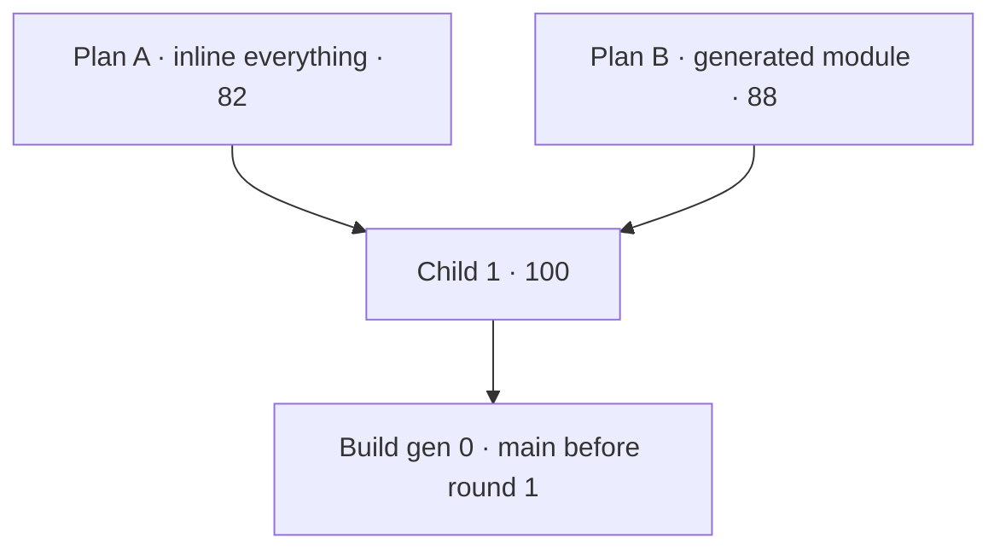

### Build generations

| Gen | Parent | What changed | Score | Best so far |
| --- | --- | --- | --- | --- |
| 0 | main (e702c16) | nothing yet: the scorecard alone | 12 | 12 |
| 1 | gen 0 | measured ZIP miles (Task 2) | 17 | 17 |
| 2 | gen 1 | zones, travel module (Task 3); guess marking (Task 4) | 32 | 32 |
| 3 | gen 2 | truck "+ travel", homepage zones and metro copy (Task 6); score moved to real 360px emulation | 50 | 50 |
| 4 | gen 3 | quote page prices travel, far ZIP call back, 16px and 48px fixes (Task 7) | 70 | 70 |
| 5 | gen 4 | checkout and thanks travel lines (Task 8) | 80 | 80 |
| 6 | gen 5 | scorecard reads nested tags (the thanks page was right, the reader was not) | 85 | 85 |
| 7 | gen 6 | Discord, email, database, dashboard (Task 9) | 95 | 95 |
| 8 | gen 7 | photo prompt and CLAUDE.md (Task 10); GUESSES.md picked up CLAUDE.md's description of the marker | 83 | 95 |
| 9 | gen 8 | CLAUDE.md excluded from the guess scan (it documents the convention) | **100** | **100** |

Every generation scored against the same 15 checks; the only regression
(gen 8, 95 → 83) was one stale generated list, fixed in gen 9.

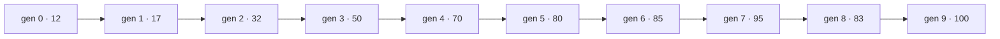

---

## Round 2: pages and site parts

Rubric for this round (10 points each): **coverage** of the spec's round 2;
**one source** (each repeated part written once); **doorway defence** (real,
different local copy per town); **drift protection** (every generated page
checked); **testable**; **house style**; **founder can edit** (copy in one
obvious, plain place); **guesses marked**; **mobile and copy rules** (16px,
48px, no dashes); **small steps**.

### Plan A: port the Scoops Co. builders as they are

`build-chrome.mjs` and `build-home-layout.mjs` copied over. Each town page is
bootstrapped once from a template and its copy is then edited on the page,
between `CITY:` markers. The town list lives in the script.

| Coverage | One source | Doorway | Drift | Testable | House | Editable | Guesses | Rules | Steps | **Total** |
| --- | --- | --- | --- | --- | --- | --- | --- | --- | --- | --- |
| 9 | 7 | 7 | 10 | 8 | 10 | 6 | 8 | 9 | 8 | **82** |

Weak spots: 40 pages bootstrapped from one template are near copies until
someone rewrites each; ZIPs typed again in the script; the founder edits 40
HTML files.

### Plan B: data driven town pages

A `towns.config.mjs` holds every town (ZIPs and all copy). Town pages are
generated whole from `index.html` plus that data; the hub too. Standalone
pages (FAQ, legal, 404) are written by hand with chrome markers.

| Coverage | One source | Doorway | Drift | Testable | House | Editable | Guesses | Rules | Steps | **Total** |
| --- | --- | --- | --- | --- | --- | --- | --- | --- | --- | --- |
| 10 | 10 | 9 | 10 | 10 | 7 | 7 | 9 | 9 | 7 | **88** |

Weak spots: 40 towns of copy inside one JavaScript file is easy to break with
a stray quote; one big generator lands in one step.

### Child 1 (A × B)

From B: data driven, generated whole, uniqueness tested. From A: the chrome
builder ported nearly verbatim, and `CITY:` markers placed in `index.html`
itself so the homepage declares what a town page swaps. Built in small steps
(chrome, standalone pages, generator on three towns, then all forty, then the
hub).

| Coverage | One source | Doorway | Drift | Testable | House | Editable | Guesses | Rules | Steps | **Total** |
| --- | --- | --- | --- | --- | --- | --- | --- | --- | --- | --- |
| 10 | 10 | 10 | 10 | 10 | 10 | 8 | 9 | 9 | 10 | **96** |

Still short: copy in a JS file (editable 8), and guesses in copy need a
simpler mark than an HTML span (guesses 9), and nothing yet checks text size
on the new pages (rules 9).

### Child 2 (child 1 + one mutation)

One plain text file per town, `content/towns/<slug>.md`: a few `key: value`
lines (name, state, ZIPs, the one line under the headline, neighborhoods),
then `## Local` paragraphs and `## FAQ` with `Q:` and `A:` lines. The folder
is the town list. `[[double brackets]]` mark a guess and print red with an
asterisk. The scorecard probes text size and tap size on every new page type.

| Coverage | One source | Doorway | Drift | Testable | House | Editable | Guesses | Rules | Steps | **Total** |
| --- | --- | --- | --- | --- | --- | --- | --- | --- | --- | --- |
| 10 | 10 | 10 | 10 | 10 | 10 | 10 | 10 | 10 | 10 | **100** |

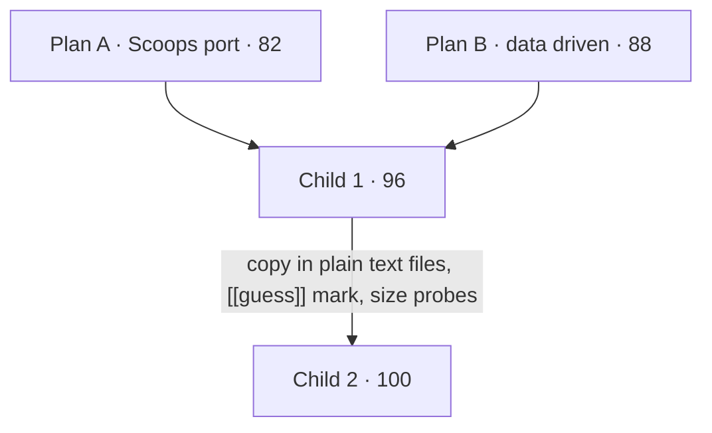

Plan: `docs/superpowers/plans/2026-10-07-round-2-pages.md`.

### Build generations

| Gen | Parent | What changed | Score | Best so far |
| --- | --- | --- | --- | --- |
| 0 | main (e2133dd) | nothing yet: the round 2 scorecard alone | 15 | 15 |
| 1 | gen 0 | chrome, analytics, banner (Task 2); FAQ, privacy, terms, 404 (Task 3) | 25 | 25 |
| 2 | gen 1 | town generator and all forty towns (Tasks 4 and 5) | 75 | 75 |
| 3 | gen 2 | hub page, zone list linking towns, 16px labels (Task 6); docs (Task 7) | **100** | **100** |

Round 1 re-scored at 100 after round 2: nothing it checks regressed.

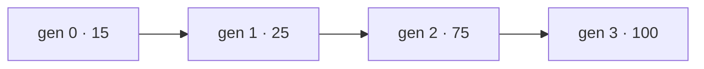

---

## Round 3: business docs and follow-up

Rubric (10 points each): **coverage**; **one source** (prices, zones and
towns in the docs come from the config, not retyped); **accuracy** (no
leftover dog or Scoops Co. facts, no claims we can't back, guesses marked);
**safety** (helpers draft by default, never auto post, quiet hours, opt out);
**testable**; **house style**; **founder can use it** (plain checklists);
**guesses marked**; **copy rules**; **small steps**.

### Plan A: port the Scoops Co. docs and helpers, swap the words

| Coverage | One source | Accuracy | Safety | Testable | House | Usable | Guesses | Rules | Steps | **Total** |
| --- | --- | --- | --- | --- | --- | --- | --- | --- | --- | --- |
| 9 | 5 | 6 | 10 | 6 | 9 | 8 | 7 | 7 | 8 | **75** |

Fast, and the helpers' safety rules carry over intact. But every price and
ZIP is retyped (they drifted at Scoops Co. twice), and a word swap leaves
dog facts hiding in the details.

### Plan B: write fresh, numbers generated

| Coverage | One source | Accuracy | Safety | Testable | House | Usable | Guesses | Rules | Steps | **Total** |
| --- | --- | --- | --- | --- | --- | --- | --- | --- | --- | --- |
| 10 | 10 | 9 | 8 | 8 | 7 | 8 | 8 | 9 | 7 | **84** |

Accurate and drift proof, but rewriting the helpers' guardrails from scratch
risks losing hard won rules (quiet hours, dedupe, the A2P gate).

### Child (A × B)

From B: a `build-docs` step writes the price table, zones and town count into
the docs and the helpers' shared context between BUILD markers, checked in
`npm test`; everything else written fresh for junk removal. From A: the
helpers' guardrails carried over word for word where they are not about dogs
(MODE draft, quiet hours, dedupe, the SMS gate, never auto post). Added: the
customer emails the helpers send are cleaned to the copy rules and tested by
rendering them; the owner booking email is test first.

| Coverage | One source | Accuracy | Safety | Testable | House | Usable | Guesses | Rules | Steps | **Total** |
| --- | --- | --- | --- | --- | --- | --- | --- | --- | --- | --- |
| 10 | 10 | 10 | 10 | 10 | 10 | 10 | 10 | 10 | 10 | **100** |

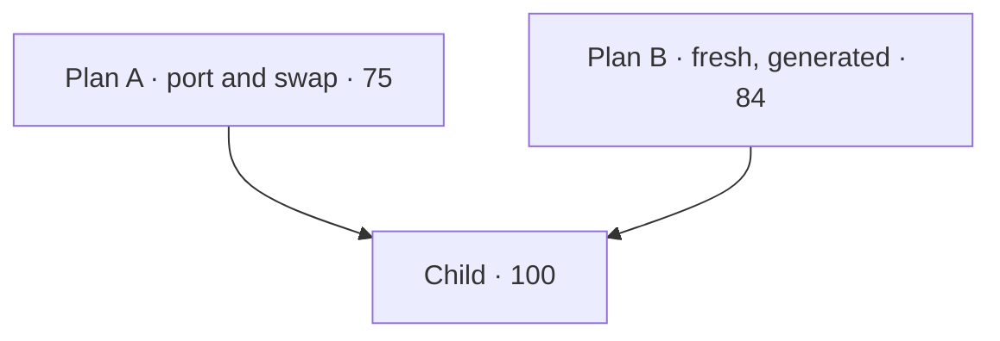

Plan: `docs/superpowers/plans/2026-10-07-round-3-business.md`.

### Build generations

| Gen | Parent | What changed | Score | Best so far |
| --- | --- | --- | --- | --- |
| 0 | main (ddb27df) | nothing yet: the round 3 scorecard alone | 10 | 10 |
| 1 | gen 0 | build-docs and the helpers' shared context (Task 2); not scored on its own | n/a | 10 |
| 2 | gen 1 | business plan, launch checklist, accounts, progress, punch list (Task 3) | 35 | 35 |
| 3 | gen 2 | marketing (Task 4); the copy check then caught the old business name | 55 | 55 |
| 4 | gen 3 | owner email, customer emails cleaned (Task 5); helpers (Task 6) | 95 | 95 |
| 5 | gen 4 | Supabase keep-alive, CLAUDE.md (Task 7) | **100** | **100** |

Rounds 1 and 2 re-scored at 100 after round 3.

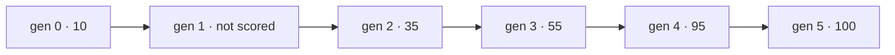

---

## Round 4: SEO tools

Rubric (10 points each): **coverage**; **one source** (the site address,
prices and FAQ text written once); **truthful schema** (structured data says
only what the page and the config say); **drift protection**; **testable now**
(useful before there is a domain); **house style**; **founder can use it**
(one command per job); **no new risk** (nothing touches the money paths
without a test); **few dependencies**; **small steps**.

### Plan A: port every Scoops Co. SEO script

Sitemap, regions, FAQ JSON-LD, schema check, share cards, host switch,
status, IndexNow, Search Console token, image pipeline, each copied and
pointed at jkr.

| Coverage | One source | Truthful | Drift | Testable now | House | Usable | No risk | Deps | Steps | **Total** |
| --- | --- | --- | --- | --- | --- | --- | --- | --- | --- | --- |
| 10 | 5 | 8 | 9 | 4 | 10 | 7 | 7 | 7 | 8 | **75** |

Weak: `https://www.example.com` stays hardcoded in a dozen scripts (the
domain swap becomes a hunt); the live probes (status, indexability) do
nothing until launch; `build-regions` and `build-faq-jsonld` would rewrite
town pages that `build-towns` owns, so the two `--check`s fight.

### Plan B: SEO from the generators that already own the pages

`build-towns` writes each town's Service, offers and FAQPage JSON-LD and
share image tag itself; one `site.config.mjs` holds the site address;
everything else written fresh and minimal.

| Coverage | One source | Truthful | Drift | Testable now | House | Usable | No risk | Deps | Steps | **Total** |
| --- | --- | --- | --- | --- | --- | --- | --- | --- | --- | --- |
| 8 | 10 | 10 | 10 | 7 | 8 | 8 | 9 | 8 | 7 | **85** |

Weak: drops tools the founder relies on at Scoops Co. (status, IndexNow,
the Search Console token, the image pipeline).

### Child (A × B)

From B: `site.config.mjs` as the one site address; town JSON-LD and share
tags from `build-towns`; FAQ JSON-LD derived from the visible FAQ only on
hand written pages. From A: every tool kept (sitemap, schema check, share
cards, status, IndexNow, Search Console token, image pipeline, a domain
switch). New: every live probe also has a local mode that checks the built
site today, so each tool is useful before launch and scored now. Share cards
and images through `sharp` (a build time dependency only, as at Scoops Co.).

| Coverage | One source | Truthful | Drift | Testable now | House | Usable | No risk | Deps | Steps | **Total** |
| --- | --- | --- | --- | --- | --- | --- | --- | --- | --- | --- |
| 10 | 10 | 10 | 10 | 10 | 10 | 10 | 10 | 10 | 10 | **100** |

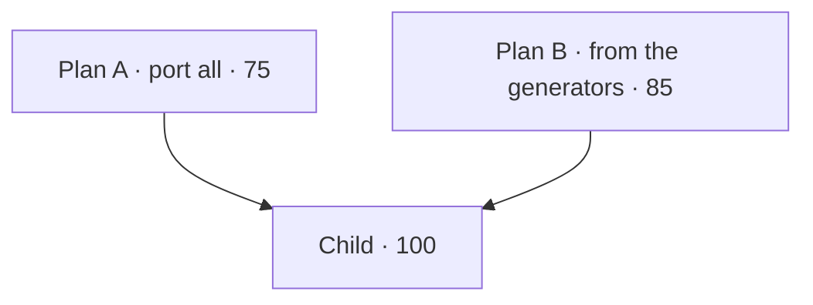

### Build generations

| Gen | Parent | What changed | Score | Best so far |
| --- | --- | --- | --- | --- |
| 0 | main (2182f9b) | nothing yet: the round 4 scorecard alone | 15 | 15 |
| 1 | gen 0 | one site address and the domain switch (Task 2); structured data (Task 3); not scored on their own | n/a | 15 |
| 2 | gen 1 | sitemap, robots, llms.txt, indexability (Task 4) | 65 | 65 |
| 3 | gen 2 | the placeholder domain named once; comments may name it | 70 | 70 |
| 4 | gen 3 | share cards on every page (Task 5) | 80 | 80 |
| 5 | gen 4 | the photo pipeline and its test (Task 5) | 90 | 90 |
| 6 | gen 5 | status, IndexNow, Search Console token (Task 6) | **100** | **100** |

The last check of the round 4 scorecard re-runs rounds 1 to 3: all three
still 100.

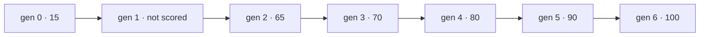

---

## Round 5: blog, Spanish, extras

Rubric (10 points each): **coverage**; **one source** (a town's English and
Spanish copy edited in one place; prices never typed into posts);
**editable** (plain text files, not HTML); **Spanish quality** (written for a
reader in Spanish with "tú", not word swapped; nothing left in English that a
Spanish reader meets before checkout); **SEO correctness** (hreflang pairs,
canonicals, sitemap, schema); **drift protection**; **testable**; **money
safety** (the founding offer is computed on the server, off by default,
tested); **copy rules**; **small steps**.

### Plan A: port Scoops Co.'s pieces as they are

Blog posts as hand written HTML; Spanish by Scoops Co.'s phrase map over
the homepage template, with Spanish town pages translated from the English
town pages phrase by phrase; commercial form and founding offer copied.

| Coverage | One source | Editable | Spanish | SEO | Drift | Testable | Money | Rules | Steps | **Total** |
| --- | --- | --- | --- | --- | --- | --- | --- | --- | --- | --- |
| 10 | 6 | 5 | 6 | 9 | 8 | 7 | 9 | 8 | 7 | **75** |

A phrase map works for the shared template, but forty towns of local copy
translated phrase by phrase reads as a machine wrote it, and hand written
HTML posts are hard for the founder to edit.

### Plan B: everything from content files

Posts are `content/blog/en/*.md` and `content/blog/es/*.md`; each town file
gains its Spanish copy beside the English; the homepage template is
rewritten in Spanish as its own file.

| Coverage | One source | Editable | Spanish | SEO | Drift | Testable | Money | Rules | Steps | **Total** |
| --- | --- | --- | --- | --- | --- | --- | --- | --- | --- | --- |
| 9 | 7 | 10 | 10 | 9 | 7 | 8 | 8 | 9 | 7 | **84** |

A separate Spanish homepage drifts from the English one the first time the
homepage changes; there is no check that catches it.

### Child (A × B)

From A: the phrase map for the shared homepage template (`i18n/es.json`),
so the Spanish homepage, towns and hub are always the English template
translated, and the build lists any phrase with no Spanish. From B: posts
and town copy in plain text files, a town's Spanish beside its English in
the same file, Spanish written for the reader. New: the founding offer test
first and computed on the server; hreflang pairs checked both ways.

| Coverage | One source | Editable | Spanish | SEO | Drift | Testable | Money | Rules | Steps | **Total** |
| --- | --- | --- | --- | --- | --- | --- | --- | --- | --- | --- |
| 10 | 10 | 10 | 10 | 10 | 10 | 10 | 10 | 10 | 10 | **100** |

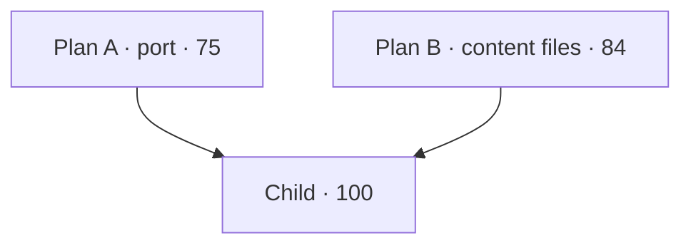

### Build generations

| Gen | Parent | What changed | Score | Best so far |
| --- | --- | --- | --- | --- |
| 0 | main (292f003) | nothing yet: the round 5 scorecard alone | 25 | 25 |
| 1 | gen 0 | founding offer, off, computed on the server (Task 2); commercial request form (Task 3); not scored at their commits | n/a | 25 |
| 2 | gen 1 | twelve posts and the blog index (Task 4); first run 20 (a post description too long broke `npm test`), then 60, then 65 with the blog linked from the footer | 65 | 65 |
| 3 | gen 2 | Spanish homepage through the phrase list, Spanish scripts, hreflang and the language switch, Spanish FAQ (Task 5) | 75 | 75 |
| 4 | gen 3 | Spanish sections in all 40 town files, es/ town pages and hub (Task 6) | 80 | 80 |
| 5 | gen 4 | the twelve posts in Spanish and es/blog/ (Task 7) | **100** | **100** |

The last check of the round 5 scorecard re-runs rounds 1 to 4: all four
still 100. Two older checks were generalised on the way, not loosened: a
folder's page is listed as the folder (`/blog/`, `/es/`), as its canonical
says, and a town page's language switch is its own (it goes to that town's
Spanish page), so round 2 compares the rest of the page.

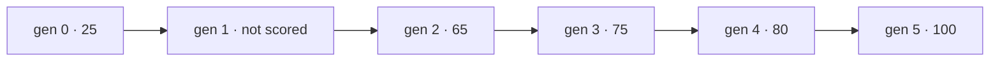

## Part 1 complete

| Round | What | Plan child | Build |
| --- | --- | --- | --- |
| 1 | service area and travel pricing | 100 | 100 |
| 2 | pages and site parts | 100 | 100 |
| 3 | business docs and follow-up | 100 | 100 |
| 4 | SEO tools | 100 | 100 |
| 5 | blog, Spanish, extras | 100 | 100 |

Next: Part 2, the walkthrough with the founder, then Part 3, the photo first
quote with the on site upcharge (its own spec).

## Round 6: the order flow (no truck, paid after the job)

Spec: `docs/superpowers/specs/2026-10-10-order-flow-design.md`. Rubric: the
round 1 criteria, with **clear to the customer** meaning the total, the travel
line and the "charged after the job" rule wherever a price shows, on a phone
and a desktop, and **failure handling** meaning stale quote, full window,
outside the area, declined final charge, bookings closed reservation,
customer says no and late cancel.

### Plan A: rebuild in place

Rewrite `book/quote.html`, `api/create-booking.js` (SetupIntent),
`api/stripe-webhook.js` and `api/visit-update.js` (after job actions) where
they stand; prices for the final charge in a second BUILD block.

| Coverage | Authority | One source | Copies | Testable | Style | Clear | Guesses | Failures | Steps | **Total** |
| --- | --- | --- | --- | --- | --- | --- | --- | --- | --- | --- |
| 9 | 9 | 8 | 5 | 8 | 9 | 9 | 9 | 9 | 6 | **81** |

Open day logic lives in the page and in `schedule.js` separately; big files
rewritten whole.

### Plan B: a new order module beside the old flow, then one switch

New `book/order.html`, `api/book.js`, `api/charge-job.js`, `api/windows.js`,
and one generated order module; the old flow retired in one task at the end.

| Coverage | Authority | One source | Copies | Testable | Style | Clear | Guesses | Failures | Steps | **Total** |
| --- | --- | --- | --- | --- | --- | --- | --- | --- | --- | --- |
| 9 | 10 | 9 | 7 | 9 | 8 | 9 | 9 | 8 | 6 | **84** |

Two booking APIs, two capacity endpoints and two order pages side by side
for nine tasks, 13 functions mid round, and a large risky switch commit.

### Child (A × B), plan to be written as `docs/superpowers/plans/2026-10-10-round-6-order-flow.md`

From B: one generated order module written twice byte identical
(`api/_lib/order-config.js`, `js/order-config.js`: sizes, `ITEMS` units,
`sizeForUnits`, windows, caps, `openDays` in Pacific time, `totalFor`, cancel
terms, consent version), the `travel.js` pattern; size card HTML generated
into BUILD blocks (crawlable, translated by build-es); page logic in
`js/order.js`, `js/size-cards.js`, `css/order.css`; the webhook branches on
the event object's own `metadata.kind` so a final charge never reads as a
new booking; the town files and post that say "tap items" rewritten;
`terms.html` on paying and late cancels.

From A: the server rebuilt in place: `create-booking.js` makes the
SetupIntent and `day-capacity.js` answers dates and windows (no second
booking API; functions stay at 10, under Vercel Hobby's 12); the after job
actions (finish with a dry run price preview, late fee, customer said no, on
my way) in `visit-update.js` behind the admin token, priced from the order
module; a shared `scripts/lib/fake-stripe.mjs` for the tests and the score
server, which runs the real API functions; `quote.html` rewritten in place in
two tasks (no card yet, then pay), each mergeable because the gates are
closed.

Both accept: the last window race fails open; the dashboard shows a window
over its cap.

| Coverage | Authority | One source | Copies | Testable | Style | Clear | Guesses | Failures | Steps | **Total** |
| --- | --- | --- | --- | --- | --- | --- | --- | --- | --- | --- |
| 10 | 10 | 10 | 9 | 10 | 10 | 9 | 9 | 9 | 8 | **94** |

Clear 9: a wallet sheet in setup mode may not show the amount on every
device. Failures 9: the last slot race is accepted. Steps 8:
`create-booking.js` and `quote.html` still change whole, behind closed gates.

Open founder question: the scroll road truck and the Junk Toss game stay
unless the founder says otherwise.

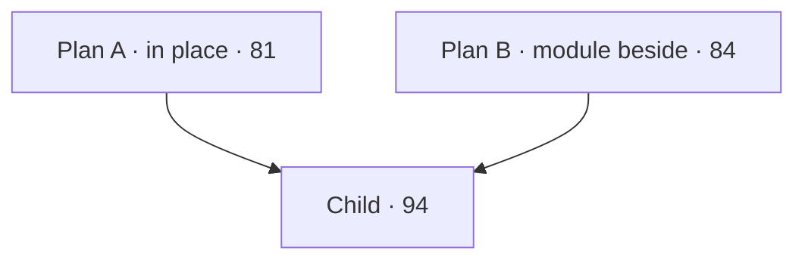

### Build generations

| Gen | Parent | What changed | Score | Best so far |
| --- | --- | --- | --- | --- |
| 0 | feat/order-flow (1b7afac) | nothing yet: the round 6 scorecard alone (shared fake Stripe, real API routes and a Stripe.js stub in the score server, click and type helpers in the browser driver); only `tests` and `earlier` pass | 10 | 10 |
| 1 | gen 0 | Task 2: `SCHEDULE`, `POLICY` and `photo` in the config, the order module written whole to `api/_lib/order-config.js` and `js/order-config.js`, `market` on `travelFor`, `test-order-config` in `npm test`; `one-source` still fails only because later tasks' files (js/order.js, js/size-cards.js) do not exist yet | 10 | 10 |
| 2 | gen 1 | Task 3: visit columns for the window, quote, payment and consent (migration folded into `db/schema.sql`), `db.slotCounts` and idempotent `createBookedVisit`, `getVisit` now carries the customer, `day-capacity?market=` answers dates and windows and fails open (old weekday answer kept without `market` until Task 4); `windows` passes | 14 | 14 |
| 3 | gen 2 | Task 4: `create-booking` saves the card (customer plus SetupIntent, consent stamped by the server, window capacity, no PaymentIntent, subscription, quarterly or coupon); founding spots counted on customers; `server` passes; `build-pricing` no longer writes prices into create-booking | 24 | 24 |
| 4 | gen 3 | Task 5: `setup_intent.succeeded` with its own `kind: 'booking'` sets the customer's default card, writes the customer and the visit (idempotent, fail soft), keeps quote photos, sends the booked confirmation (day, window, total, travel line, the rule), the Discord ping and the owner email; a redelivery pings nothing new; a final charge is never read as a booking; reminders show the window; `webhook` half done (`final charge` section comes in Task 6) and the email half of `clear` is in place | 24 | 24 |
| 5 | gen 4 | Task 6: `finish` (final size priced on the server: booked size at its quoted cents, another size at today's price, travel always as booked; founding percent off from the SetupIntent; agreement needed for a higher price; one off session charge keyed per visit and size; a paid, invoiced or no charge visit refuses a second), `declined`, `late-fee`, `en-route`; a decline sends a hosted invoice and alerts Discord and the owner once; the webhook marks `final_charge`, `late_fee` and their hosted invoices paid and sends the receipt, never a booking; receipt, payment needed and late fee emails; `test-charge` in `npm test`; `final-charge` and `webhook` pass | 40 | 40 |
| 6 | gen 5 | Task 7: the dashboard job card (size booked, quoted total, day and window, payment status and invoice link; On my way opens the text and stamps `en-route`; Finish and charge shows a dry run price and an agreement box when the size or the price is higher; Late cancel fee only when `ORDER.isLateCancel`; Customer said no confirms in the page, no browser dialogs; 48px buttons and 16px text at 360px); `admin-data` returns the new visit columns; `test-admin` checks the four actions; the scorecard dashboard check sets the service key so it reaches the auth check; `dashboard` passes | 43 | 43 |
| 7 | gen 6 | Task 8: the order page (`book/quote.html` rebuilt, same address): five size cards generated into `BUILD:order-sizes` (photo, name, what fits, price red while guessed, "+ travel" until the ZIP), `js/size-cards.js`, `js/order.js` (one state object, sections open in turn, no Continue button; ZIP from `?zip=` or `quoteZip`; far ZIP keeps the price by email lead; day chips and windows from `day-capacity`, full ones greyed and labelled "Full", soonest open day picked; five contact fields with autocomplete; notes behind "Anything we should know?"; the rule beside Book; gates closed: Book saves the reservation lead and shows the reserved state), `css/order.css` (phone: one column and a fixed bar that hides while typing; 900px and up: two columns, sticky summary, cards three to a row), the photo quote moved to `js/photo-quote.js` (the load builder borrows it until Task 10), quote JSON-LD one time only, the order page footer at 16px; round 1 `quote-zone`, `quote-far` and `mobile` generalised to the order page, round 6 `phone` walks to the contact step before it types; `phone`, `one-source` and `guesses` pass, the order page halves of `sizes`, `desktop`, `clear` and `failures-ui` pass (their other halves wait on Tasks 9 and 10) | 58 | 58 |
| 8 | gen 7 | Task 9: the pay step with the gates open (`BOOKINGS_OPEN_CLIENT` and `STRIPE_PUBLISHABLE_KEY` on the order page; Stripe.js loaded only then): one Elements group in setup mode, Apple Pay or Google Pay (Express Checkout, email and phone required) above the boxed card form (Payment Element, name, email and phone passed at confirm), "Secured by Stripe", the rule above one box ("I agree to the terms, and to this card being charged after the job.") that gates the card and the wallet alike; Book: `elements.submit()`, `POST /api/create-booking` (consent and version, one `attemptId` per visit), `confirmSetup` (`redirect: if_required`), thanks.html; a stale quote takes the server total and says so, a full window greys and asks for another, a closed day picks again; thanks.html rebuilt (size, travel line, total, day and window, "charged after the job", what happens next, back from a bank page); book/checkout.html a noindex redirect (vercel.json plus a meta refresh keeping the query); day-capacity's weekday branch, `DAILY_CAP` and `scheduledVisitCountsByWeekday` deleted (R9); `build-pricing` drops the checkout block; `status` reads the order page; round 1 `checkout`, `guesses`, `mobile` and round 2 `site-js` generalised to the order page, the scorecard's `fillOrder` fills the card and box only with the gates open and asserts neither shows when closed (R15), `failures-ui` adds no booking without the box (card or wallet); `clear`, `failures-ui` and `redirect` pass, `taps` passes from the order page's cards and waits on the homepage cards (Task 10) | 70 | 70 |
| 9 | gen 8 | Task 9b, pay at booking (founder, 2026-10-10: "payments have to be accepted at time of bookings so i can pay hauler"; rulings R17 to R19): `create-booking` makes one PaymentIntent for the quoted total (less any founding discount) with `setup_future_usage: off_session` and no SetupIntent (idempotency as R10), and answers `paymentIntentClientSecret` and `amountCents`; the webhook books on `payment_intent.succeeded` whose own `kind` is `booking` (visit `paid` with `paid_cents` and the booking PaymentIntent, default card, `booking_notified_at` dedupe, email keys from the PaymentIntent; a declined booking card pings Discord only; the `setup_intent.succeeded` path is gone; a PaymentIntent's legacy plan is read from its own metadata only); `visit-update`: `finish` settles the difference against what was paid (bigger: agreement, an off session charge keyed `visit:<id>:diff:<size>` with `allow_redirects: never`, a decline or an unfinished payment canceled then invoiced and the job still completed; smaller: a refund on the booking payment keyed `visit:<id>:refund:<size>`; same: no Stripe call; the final size written before money moves so a retry can only repeat it), `cancel-refund` replaces `late-fee` (full refund, or less the late fee inside the cancel window), `declined` refunds less the refusal fee, both only for a booking still ahead and only what is unrefunded, with dry runs; skip and cancel refuse a paid booking; visits gain `paid_cents`, `refunded_cents` and the `declined` status, unique on the booking PaymentIntent; consent version `2026-10-10b`; emails: paid today, receipt with paid, adjusted and final, payment needed for the difference, `refundNotice`; the order page pays now (`mode: payment`, `elements.update` follows the total, `confirmPayment`), "Book and pay $X", the new consent and the pay now rule ("when you book" while closed), every edit (the ZIP too) clears the failure line; thanks.html says paid today and a difference settled after the job; the dashboard shows Charge $X more, Refund $X or No change from the dry run, Cancel and refund and Customer said no with the server's refund, asked in the page and disabled in flight; scorecard `server` proves one PaymentIntent and refusals with no Stripe object through the real handler, `final-charge` names its six sections, `clear` looks for the pay now rule, `dashboard` names `cancel-refund`; still failing only Task 10's homepage checks (`no-truck`, `sizes`, `desktop`, `taps` at the homepage card, `contact`) | 70 | 70 |
